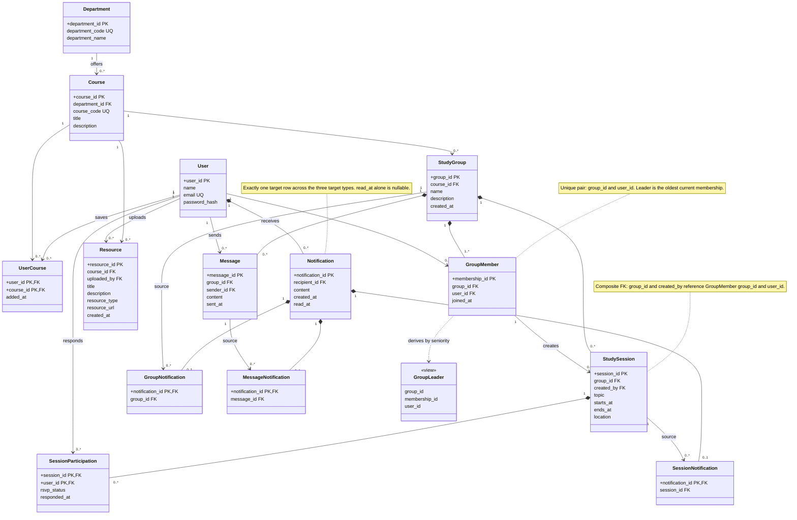
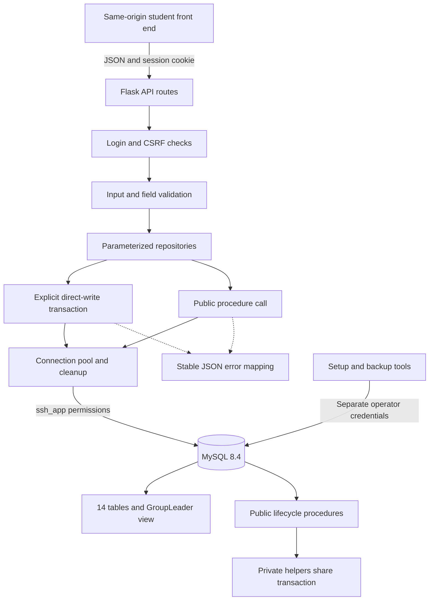
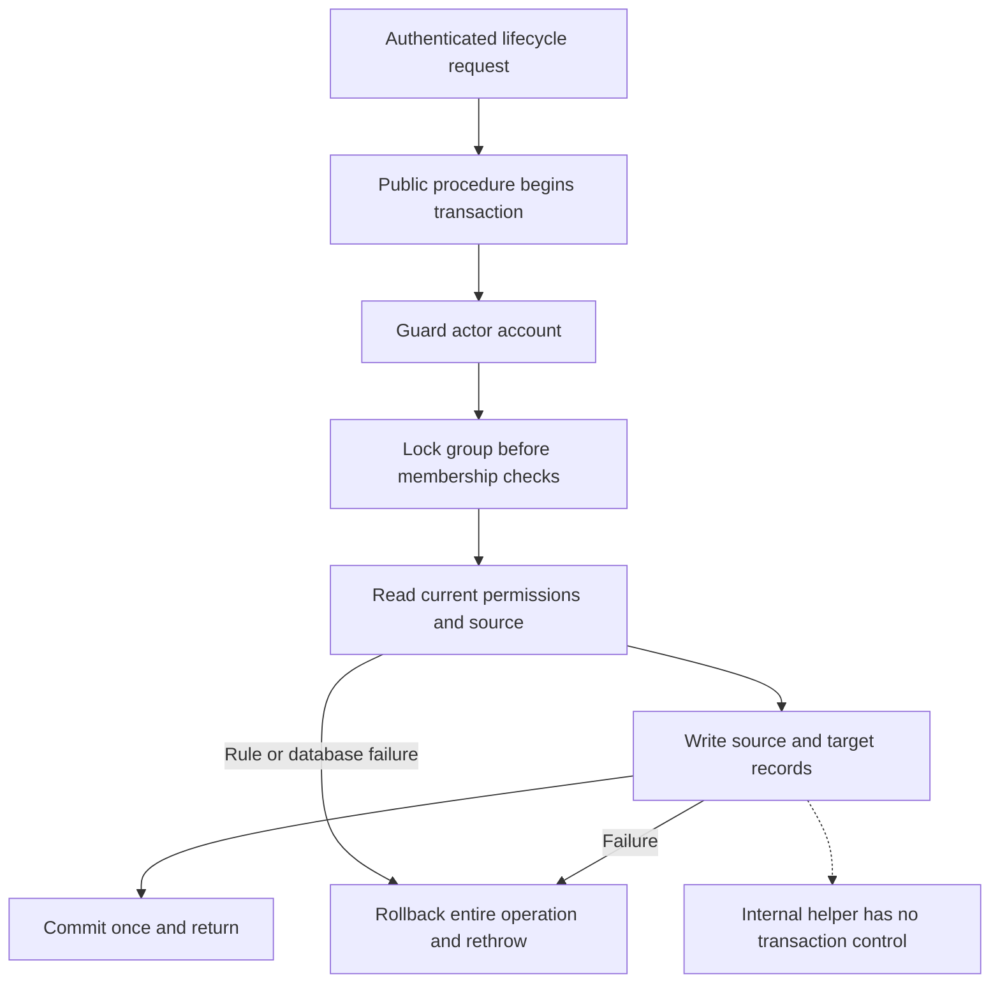
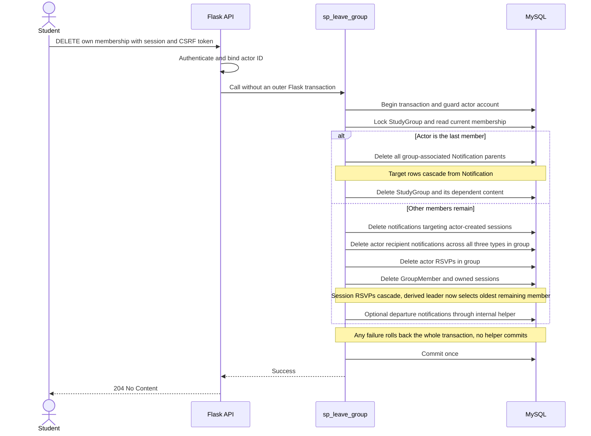
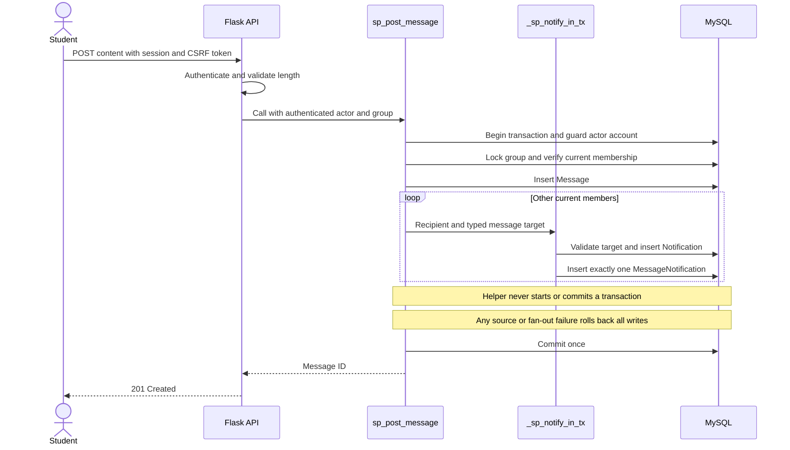
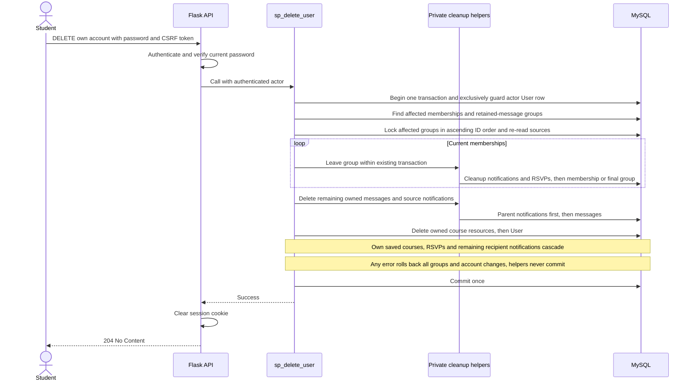

# Spartan Study Hub: architecture and UML

This document matches [IMPLEMENTATION_PLAN.md](IMPLEMENTATION_PLAN.md) and the canonical 14-relation BCNF schema. It describes a backend to be implemented and tested. There is one registered-student account type; permissions are derived from group membership, current leadership and content ownership. The course catalog is read-only through the application and is populated by setup/maintenance scripts.

## 1. Data model

The diagram shows all 14 stored relations and the derived GroupLeader view. PK and FK labels describe the relational mapping; joined_at is immutable. UserCourse and SessionParticipation have composite primary keys. Each notification target reuses its Notification parent's primary key.

The GroupLeader view chooses one membership per nonempty group using `(joined_at, membership_id)` order. It adds no stored table or column. Student identity, password_hash and the catalog schema remain as specified in the canonical README.

The three optional one-to-one notification associations do not individually enforce the combined exactly-one rule. Atomic parent/target insertion and restricted direct writes enforce that invariant. Source deletion removes Notification parent records first, which cascade to their target rows; only then is the referenced group/message/session deleted.

## 2. Application and database layers

Routes authenticate, validate CSRF and inputs, bind the current student ID, call repositories, and serialize public results. Authentication state is loaded from the database for each authenticated request. The database service account is shared by requests; row-level ownership still has to be checked explicitly.

Public lifecycle procedures own their transactions, group locks and lifecycle authorization checks. Repositories never wrap such a call in a second transaction. Direct writes are limited to own-account fields, own saved courses, own course resources and recipient-filtered read_at changes, using the column grants and account guards specified in the implementation plan.

Connection checkout uses autocommit for ordinary reads and UTC. Explicit write transactions start and finish once. Cursors/result sets are consumed and unexpected open transactions are rolled back before returning a connection to the pool.

## 3. Transaction and lock boundaries

The actor account guard is shared for ordinary operations and exclusive for account deletion. Within the group scope, StudyGroup is the serialization root and all affected groups are locked in ascending ID order for a multi-group operation. Group creation is the special case: insert the new group and its first member atomically rather than trying to lock a group that does not yet exist.

Internal `_in_tx` helpers never start, commit or roll back a transaction. Exception handling belongs to the public owner. Account deletion reuses these helpers inside one transaction instead of calling public procedures with independent commits. Deadlocks remain possible during fan-out and FK checks; a failed operation is fully rolled back and only explicitly rollback-safe failures receive bounded whole-operation retries.

## 4. Sequence: leaving a group

There is no post-removal leader authorization in the last-member branch. The caller was already verified as the departing member while the group was locked. Session notifications are removed before membership deletion triggers session cascades, so source RESTRICT references do not block a correct departure.

Existing messages and course resources survive an ordinary leave. A student may still manage their own retained message without receiving access to the rest of that former group's content.

## 5. Sequence: posting a message

No notification is externally visible as a committed parent without its target. The source message and all recipient notifications succeed or roll back together.

## 6. Sequence: deleting an account

Direct writes to UserCourse and Resource also guard the actor's User row, so they cannot create new dependent content halfway through account deletion. A concurrent operation either completes first or fails after deletion. FK-related deadlocks are handled by the same bounded rollback-and-retry policy; an ambiguous network failure after commit is not blindly replayed.

## 7. Authentication, permissions and API boundaries

The signed Flask cookie contains user_id, a credential tag and a CSRF nonce, not the password or stored password hash. The credential tag is an application HMAC derived from the current password_hash as described in the implementation plan. Changing the password invalidates old tags without modifying the schema. Explicit logout clears only the current browser's session. Every state-changing route checks the session-bound CSRF token and appropriate origin.

| Capability | Required relationship |
|---|---|
| Browse catalog, group summaries and course resources | Authenticated student |
| Save a course or manage own account | Same student |
| Create or join a group | Authenticated student; no saved-course prerequisite |
| Change or delete a group | Current derived leader |
| Read protected group content, create sessions, RSVP or post messages | Current membership |
| Change/delete a session | Creator ownership and surviving creator membership |
| Change/delete a message | Sender ownership |
| Change/delete a resource | Uploader ownership |
| Read/mark/delete a notification | Recipient ownership |

The API exposes no catalog-write endpoints or user-management override. Student clients cannot select another actor ID, mutate ownership fields, call stored-procedure names dynamically, or execute private helper routines.

Message edits use `sp_update_message`, group edits use `sp_update_group`, and notification deletion uses `sp_delete_notification`, so the API does not depend on table writes denied by the application grants. Course resources and saved courses use the expressly permitted direct-write paths with ownership filters. Feed cursors contain timestamp plus ID to match their ordering; cursors never replace access checks.

## 8. Verification responsibilities

The implementation must demonstrate the following before this design is considered validated:

- Data model and physical keys agree with the 14-table, 59-column schema and all 21 foreign keys.
- Notification parent/target creation and source deletion preserve exactly one target per surviving notification.
- Public transaction owners are never nested and private helpers never commit.
- Group operations take the shared root lock before current authorization checks.
- Last-member departure and account deletion complete without relying on a departed leader.
- Failure-injection tests prove rollback across source writes, fan-out and multi-group account cleanup.
- Concurrent departures, joining, RSVPs, edits and account deletion preserve the agreed invariants.
- Restricted grants permit each documented API path and deny direct lifecycle writes/helper execution.
- Creator/sender/uploader/recipient and leader permissions match the matrix, including denials to a leader editing somebody else's content.
- Password changes invalidate another client's old credential cookie; CSRF checks cover login and every other state-changing route.
- Pagination, database errors and pool cleanup behave as specified, and performance is measured on representative data.

The documents provide implementation contracts, not evidence that these checks have passed. The detailed route list, error mapping, grants, indexes, delivery order and test cases are in [IMPLEMENTATION_PLAN.md](IMPLEMENTATION_PLAN.md).
